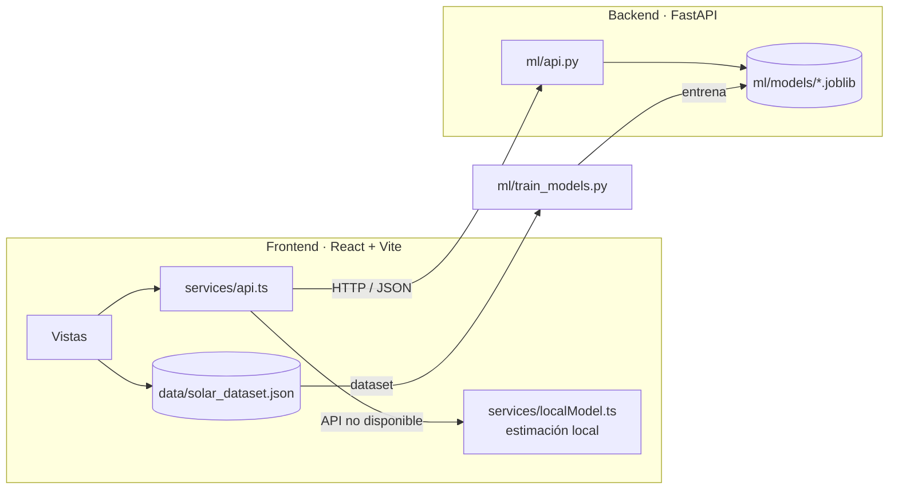

# ☀️ HeliosDash — Helios Solar

**Dashboard de energía solar para hogares en México con modelos de Machine Learning** que predicen la generación de los paneles, el costo de la factura de CFE y el riesgo de bajo rendimiento según la ciudad, la estación del año y el clima.


---

## ✨ Funcionalidades

| Vista | Qué hace | Fuente de datos |
|---|---|---|
| **Análisis** | Generación por ciudad, perfil horario por estación, dispersión irradiancia vs. generación, matriz de correlación y radar por tarifa CFE | Dataset (1,500 registros, 8 ciudades) |
| **Comparador** | Compara dos ciudades lado a lado | Dataset |
| **¿Me conviene?** | Calcula cuántos paneles necesitas, cuánto cuestan, el ahorro mensual y en cuántos años recuperas la inversión | API ML / estimación local |
| **Recomendador** | Asistente paso a paso según el número de personas, la ciudad y la tarifa | API ML / estimación local |
| **¿Qué pasaría si…?** | Sliders de nubosidad, temperatura, hora y paneles con predicción de generación, costo y riesgo en tiempo real | **Modelos ML** / estimación física |
| **Alertas** | Alertas a partir de los datos y predicciones de riesgo del clasificador | Dataset + API ML |
| **Dispositivos** | Consumo de electrodomésticos y su costo con tarifas CFE reales | Cálculo local |
| **Simulador ROI** | Proyección financiera a 25 años | Cálculo local |
| **Resumen** | Dashboard tipo "monitor en vivo" | Datos simulados (demo de UI) |

## 🧠 Machine Learning

El pipeline (`ml/train_models.py`) entrena y compara **4 regresores** para predecir `Generacion_Solar_kWh`, y se queda con el que tenga mejor R²:

| Modelo | R² | MAE (kWh) | RMSE (kWh) |
|---|---|---|---|
| Linear Regression | 0.774 | 0.775 | 1.013 |
| Random Forest | 0.971 | 0.263 | 0.362 |
| **Gradient Boosting (XGBoost)** ✅ | **0.976** | **0.248** | **0.330** |
| Neural Network (MLP 128-64-32) | 0.971 | 0.280 | 0.363 |

Además entrena **3 modelos secundarios**:

- **Costo** (`Costo_Estimado_MXN`): Gradient Boosting, R² 0.947
- **Consumo neto** (`Consumo_Neto_kWh`): Gradient Boosting, R² 0.975
- **Riesgo de bajo rendimiento** (clasificación, generación < percentil 25): accuracy 0.733, F1 0.494

**Ingeniería de features:**
- Codificación cíclica seno/coseno de la hora y el mes, para que el modelo "sepa" que las 23 h están cerca de las 0 h.
- One-hot encoding de ciudad, estación, tarifa y día de la semana.
- `StandardScaler` para las variables numéricas, todo dentro de un `ColumnTransformer` que se serializa junto con el modelo.

> Las métricas completas se guardan en [`ml/metrics.json`](ml/metrics.json) y se regeneran en cada entrenamiento (split 80/20, `random_state=42`).

## 🏗️ Arquitectura



La app **degrada con elegancia**: si el backend no responde, `services/api.ts` usa estimaciones locales (modelo físico de generación y la misma lógica de recomendación que el backend) e indica en pantalla que está en *modo demo*. Así la interfaz es usable incluso si se publica como sitio estático.

## 📁 Estructura

```
├── views/              # Una vista por sección del dashboard
├── components/         # Sidebar, GlassCard, notificaciones
├── services/
│   ├── api.ts          # Cliente del backend (timeout + fallback)
│   └── localModel.ts   # Estimaciones locales sin backend
├── data/
│   ├── solar_dataset.json  # Dataset (1,500 registros)
│   └── solarData.ts        # Tipos, filtros, agregaciones y tarifas CFE
└── ml/
    ├── train_models.py # Pipeline de entrenamiento
    ├── api.py          # API REST (FastAPI)
    ├── utils.py        # Preprocesamiento, features e inferencia
    └── metrics.json    # Métricas del último entrenamiento
```

## 🚀 Cómo correrlo

**Requisitos:** Node.js 18+ y Python 3.10+

### 1. Frontend

```bash
npm install
npm run dev          # http://localhost:3000
```

Con esto basta para ver la app en modo demo.

### 2. Backend ML (opcional, para usar los modelos entrenados)

```bash
cd ml
python -m venv .venv
# Windows: .venv\Scripts\activate    |    macOS/Linux: source .venv/bin/activate
pip install -r requirements.txt

python train_models.py               # entrena con data/solar_dataset.json (~1 min)
uvicorn api:app --reload --port 8000 # docs interactivas en http://localhost:8000/docs
```

Para apuntar el frontend a otro backend, copia `.env.example` a `.env.local` y define `VITE_API_URL`.

### Endpoints principales

| Método | Ruta | Descripción |
|---|---|---|
| `GET` | `/api/health` | Estado y mejor modelo cargado |
| `POST` | `/api/predict/generation` | Generación solar (kWh) para una hora y unas condiciones dadas |
| `POST` | `/api/predict/cost` | Costo estimado y ahorro contra no tener paneles |
| `POST` | `/api/predict/net-consumption` | Consumo neto y si hay excedente |
| `POST` | `/api/risk/low-performance` | Probabilidad de bajo rendimiento |
| `POST` | `/api/recommend/panels` | Número de paneles, costo y ROI |
| `POST` | `/api/recommend/best-hours` | Horas pico de generación |
| `GET` | `/api/models/comparison` | Métricas de todos los modelos |

## 🎬 Modo demo (rama `demo`)

Esta rama genera un **build estático sin backend** para el portafolio:

```bash
npm run build:demo        # → dist-demo/ (rutas relativas, se puede servir en cualquier subcarpeta)
```

- `services/api.ts` no hace peticiones de red: responde con `services/demo/demoApi.ts`.
- **Generación y costo** salen del modelo real: `ml/export_demo_predictions.py` consulta los modelos entrenados sobre una cuadrícula ciudad × estación × hora × nubosidad y guarda `services/demo/predictions.json`, sobre el que la demo interpola.
- **Riesgo y tarifa óptima** son datos simulados que muestran el comportamiento esperado: el clasificador de riesgo actual etiqueta "bajo rendimiento" casi solo de noche, así que de día siempre responde "bajo".
- `vite.config.ts` aborta si `VITE_DEMO_MODE` se usa fuera de `--mode demo` o si el build demo define `VITE_API_URL`.
- Cada vista tiene su enlace directo por hash: `#/whatif`, `#/calculator`, `#/analysis`…

Para regenerar las predicciones después de reentrenar: `cd ml && python train_models.py && python export_demo_predictions.py`.

## ⚠️ Limitaciones conocidas

- El dataset es **sintético** (1,500 registros) y no contiene mediciones reales de instalaciones.
- La vista *Resumen* usa datos simulados para mostrar la interfaz de monitoreo.
- Las tarifas CFE son promedios aproximados de 2024–2025 por kWh y no reproducen los escalones de consumo.

## 👥 Créditos

Desarrollado por [@Rodrigo-QS](https://github.com/Rodrigo-QS) como proyecto académico, con el apoyo de [@germanibarra-code](https://github.com/germanibarra-code).
